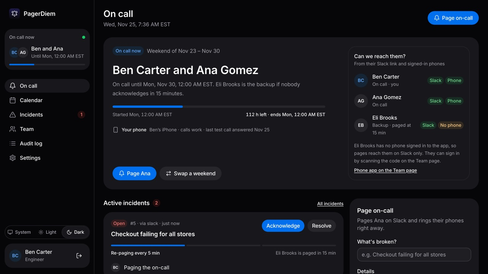

# PagerDiem 📟

[](https://github.com/PerDiemInc/pagerdiem/actions/workflows/ci.yml)
[](LICENSE)
[Project site](https://perdieminc.github.io/pagerdiem/)

**Self-hosted weekend on-call for small engineering teams.** A fair rotation, Slack paging with
escalation, a shared calendar, and sign-in locked to your Google Workspace. One Node.js process,
one database, no per-seat pricing.



## Why

Paging tools are built for large incident-response orgs and priced per seat. Many small teams just
need: *who's on call this weekend, and how do we reach them when something breaks?* PagerDiem does
exactly that, and you can run it for free.

## Features

| | |
|---|---|
| **Fair weekend rotation** | Two people per weekend by default (`PEOPLE_PER_WEEKEND`), taking turns so everyone gets the same share. Weekends run Friday 18:00 → Monday 09:00 in your time zone (configurable). |
| **Self-service** | Anyone can **add themselves** to a weekend (no limit) or **remove themselves**. Weekends below the target are flagged *needs cover*. |
| **Swap with undo** | On the calendar, **Swap** next to a name takes that person's spot. You get 10 seconds to undo before they and Slack are told. |
| **Slack paging** | Page from the web app, `/page <what broke>` in Slack, or the HTTP API. Everyone on call gets a DM with **Acknowledge / Resolve** buttons; the channel is told, with on-call people @-tagged. |
| **Escalation** | No acknowledgement → re-page every 5 min → page the backup at 15 min → `@channel` at 30 min. On weekdays pages go straight to the channel. |
| **Reminders** | DM 24 hours before your weekend, a "you're on call now" DM when it starts, and a hand-off summary in the channel when it ends. |
| **Calendar** | Month view of who's on call, plus a feed you can subscribe to from Google Calendar. |
| **Audit log** | Every add, remove and swap, grouped by day, visible to the whole team. |
| **Your team only** | Google sign-in restricted to your Workspace domain. Personal Gmail and other companies are refused. |
| **Roles** | *Admin* and *Engineer* can be on call and respond. *Non-technical* teammates (leadership, support, product) can view everything and raise an alert, but are never put on call. |

<table>
<tr>
<td></td>
<td></td>
</tr>
<tr>
<td align="center">Calendar: two people per weekend, colour-coded</td>
<td align="center">Audit log: every add, remove and swap</td>
</tr>
</table>


## Quick start (local)

Requires Node.js 22.13+ (uses the built-in `node:sqlite`).

```bash
git clone <this repo> && cd pagerdiem
cp .env.example .env
npm install
npm start          # http://localhost:3000
npm test
```

Locally, without Google or Slack keys, PagerDiem uses email + password sign-in and runs Slack in
**dry-run mode**: every message is recorded under **Settings → Recent messages** instead of being
sent. The first person to sign up becomes an admin.

## Deploy

| Guide | What you get | Cost |
|---|---|---|
| [Render + Neon + Slack](docs/deploy-render-slack.md) | Easiest. Docker web service on Render, Postgres on Neon, the Slack app, Google sign-in. | Free tiers |
| [AWS (ECS Fargate + RDS)](docs/deploy-aws.md) | Always-on container behind a load balancer, managed Postgres, secrets in Secrets Manager. | About $35–45/month |

Run **exactly one instance**: the scheduler (reminders, escalation) runs inside the web process.

## Configuration

Everything company-specific is an environment variable. See [.env.example](.env.example).

| Variable | Required | Description |
|---|---|---|
| `ALLOWED_EMAIL_DOMAINS` | production | Your Google Workspace email domain(s), comma-separated, e.g. `example.com` |
| `GOOGLE_CLIENT_ID`, `GOOGLE_CLIENT_SECRET` | production | Google OAuth client (Web application). Without them, production lets nobody in. |
| `DATABASE_URL` | production | Postgres connection string. Without it, a local SQLite file is used. |
| `SESSION_SECRET` | production | Long random string (signs sessions and the calendar feed link) |
| `PUBLIC_URL` | | The app's public URL. Set automatically on Render. |
| `TEAM_NAME`, `APP_NAME` | | Shown on the sign-in page and calendar feed |
| `TEAM_TIMEZONE`, `SHIFT_START`, `SHIFT_END` | | Defaults: `America/New_York`, `FRI 18:00`, `MON 09:00` |
| `PEOPLE_PER_WEEKEND` | | Default `2` |
| `REMINDER_HOURS_BEFORE`, `REPAGE_EVERY_MINUTES`, `ESCALATE_AFTER_MINUTES` | | Defaults `24`, `5`, `15` |
| `SLACK_BOT_TOKEN`, `SLACK_SIGNING_SECRET` | for Slack | From your Slack app |
| `SLACK_ONCALL_CHANNEL` | for Slack | Channel ID for on-call posts (invite the bot) |
| `SLACK_TEAM_ID` | recommended | Your Slack workspace ID. Requests from other workspaces are rejected. |
| `SLACK_ENGINEERS_GROUP_ID` | | Slack user group (e.g. @engineers) tagged when an incident starts |
| `API_TOKEN` | | Bearer token for the HTTP API |
| `WHATSAPP_GROUP_URL` | | Optional team chat invite link, shown as a Join button |
| `KEEP_AWAKE` | | Self-ping every 10 min to stop free hosts from sleeping. On by default on Render. |

## Using it

- **Slack:** `/oncall` shows who's on call now and the next weekends. `/page checkout is down` pages them.
- **API:**

  ```bash
  curl -X POST "$PUBLIC_URL/api/incidents" \
    -H "Authorization: Bearer $API_TOKEN" -H "Content-Type: application/json" \
    -d '{"title":"API 5xx spike","details":"p95 > 2s on /orders","source":"monitoring"}'

  curl "$PUBLIC_URL/api/oncall" -H "Authorization: Bearer $API_TOKEN"
  ```

  Point Sentry, Datadog, Grafana or CI alerts at `POST /api/incidents`.

## How the rotation works

- The order is the **Team** page list; admins can reorder people, change roles or remove someone.
- Each weekend takes the next two engineers in order, so over a full cycle everyone gets the same number of weekends. The **Balance** box on the home page shows the counts.
- When a weekend starts, its picks are saved. Future weekends are projected from the last saved one, so people joining, leaving or being reordered never reshuffle past weekends.
- Adding yourself, removing yourself or swapping only changes that one weekend.
- The backup for a weekend is the first person on the next weekend who isn't already on call.

## Roles

Every person has one role, set by an admin on the **Team** page. The first person to sign up is an admin; everyone after starts as *non-technical* until an admin changes it.

| | Admin | Engineer | Non-technical |
|---|---|---|---|
| View the calendar, audit log and incidents | ✅ | ✅ | ✅ |
| Trigger an alert (web, `/page`, API) | ✅ | ✅ | ✅ |
| On the automatic rotation | optional | ✅ | never |
| Add or remove yourself, swap weekends | ✅ | ✅ | ❌ |
| Acknowledge or resolve incidents | ✅ | ✅ | ❌ |
| Open Team and Settings | ✅ | ✅ | ❌ |
| Change roles, reorder or remove people | ✅ | ❌ | ❌ |

Databases created before roles existed are migrated on first start: admins stay admin and everyone else becomes an engineer.

## Security model

- Production sign-in is Google only, restricted to `ALLOWED_EMAIL_DOMAINS` on a Workspace-managed account. Set the OAuth consent screen to **Internal** for a second lock at Google's end.
- Slack requests are verified with the signing secret and, with `SLACK_TEAM_ID`, restricted to your workspace.
- The API requires a bearer token. The calendar feed uses an unguessable link.
- See [SECURITY.md](SECURITY.md) to report a vulnerability.

## Development

- Plain Node.js, no framework. The only runtime dependency is `pg`.
- SQL runs on both SQLite (local, tests) and Postgres (production).
- Tests: `npm test`, or against Postgres with `TEST_DATABASE_URL=postgres://… npm test` (wipes that database).

| File | What it does |
|---|---|
| `src/time.js` | Weekend windows in the team time zone (DST-safe) |
| `src/rotation.js` | Rotation, add/remove yourself, swaps, audit log |
| `src/incidents.js` | Page → re-page → backup → channel escalation |
| `src/scheduler.js` | Once a minute: reminders, weekend start/end, escalation, swap announcements |
| `src/google.js` | Google sign-in restricted to your Workspace |
| `src/notify/` | Slack client and dry-run logging |
| `src/app.js` | Routes: web pages, Slack commands and buttons, API |
| `src/views.js` | HTML pages |

CI runs the tests on Node 22 and 24 with SQLite, and on Postgres 16. The project site in `docs/` is published to GitHub Pages by `.github/workflows/pages.yml`.

Contributions welcome. See [CONTRIBUTING.md](CONTRIBUTING.md).

## License

[MIT](LICENSE). Built at [Per Diem](https://tryperdiem.com) for our own weekend rotation.
